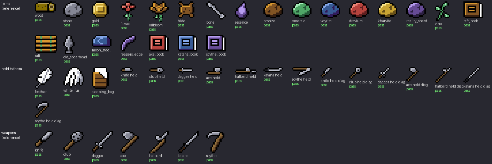

# Item style

The rules every item follows: its icon in the menus, and its drawing in the
world if it is ever placed there, whatever view that is drawn in. They are not
chosen: they are measured from the icons the user is happy with, and anything
new is held to them. `tools/item_style.py` holds the measurable half -- the
ramps, the list of icons and the checker. Read this before touching
`art/items/` or drawing a craftable that stands in the world.

The first rule of `ART_DIRECTION.md` still holds underneath: one palette. Its
second, four colours a 16px cell, is the tiles'; an icon has its own budget
(see "Colours").



## The reference

(The user, 2026-10-12.)

**Every item icon and every weapon icon, except the feather, the white fur
and the sleeping bag.** 23 items and 7 weapons. When a rule here is unclear,
the answer is whatever these do. Those three are not reference: they are held
to the rest.

The gravestone is no longer an item. Its column is still in the sheet and
nothing here reads it.

## One drawing, one ramp

An icon is **one 16 x 16 drawing in four key tones** -- line, shade, base,
lit -- **coloured by one ramp**. The drawing says what the thing is; the ramp
says what it is made of. So the ore lump is drawn once and is seven ores, the
book once and four books, and a weapon once and is the colour of the ore it
is forged in and of the shots it fires.

The ramps are the world's own: the seven ores' (`TONES` in
`art/structures/gen_cave_entrances.py`), which the caves, the cliffs and the
battle shots are also in, and the cliffs' brown. Lit to dark:

| Ramp | Tones | Colours |
|---|---|---|
| ore rock (stone) | `bcbeca` `848694` `474751` | stone, bone, the old spearhead, the shade of the feather and the white fur, a weapon's metal |
| bronze | `d89830` `815423` `341e10` | bronze, the oilbloom, hide, the raft book, the raft, the sleeping bag |
| emerald | `a8f0bc` `4fa667` `235436` | emerald, the vine |
| veyrite | `84a7e9` `375a94` `301b5a` | veyrite, moon steel, the katana book |
| dravium | `ec8476` `b6433d` `5d1e1f` | dravium, the flower, the axe book |
| kharvite | `fae488` `c9a433` `685018` | kharvite, gold |
| reality shard | `b69cee` `664b95` `2b1f40` | reality shard, essence, the reaper's edge, the scythe book |
| cliff brown | `b29e5c` `887000` `493712` | wood |

What a drawing carries that no ramp swaps:

| Part | Tones |
|---|---|
| stems, leaves, lashings | `a8f0bc` `4fa667` `235436` (the emerald ramp, fixed) |
| a page, a pillow, a feather, white fur, a glint | `fcfcfc` |
| a weapon's haft | `94703d` `785830` `3c2412` |
| the katana's grip wrap | `1e1e24` |

A new icon takes one of the eight ramps. A new ramp, or a new fixed part, is
added to the tables above and to `tools/item_style.py`, not typed into a
design script.

## Colours

**At most six besides black and white**: two materials of three tones (the
user, 2026-10-12). Most of the reference is three -- its ramp and nothing
else. The six are a flower's petals and its stem, or a weapon's metal and its
haft.

## Outline

**A 1-px black outline round the whole silhouette, and between its parts**: a
book's cover from its pages, a raft's log from the next, a blade from its
haft. 25 of the 30 reference icons are black round all of their edge. The
rest are bare only where a part is 1 px wide and two lines would fuse: a stem
(the flower, 75% of its edge; the oilbloom, 84%) or a tip (the vine, the
dagger, the halberd, 97%).

At 16 px the line is much of the drawing: black is 27% to 63% of an icon's
pixels.

## Shading

- **Light from the upper left**, as everywhere else in the game. In every
  reference icon that has shading, the ramp's dark tone lies down and to the
  right of its lit one.
- **Placed by form.** The lit tone is on the surface that faces up and left,
  the dark along the bottom and the right and under an overhang. On a lump
  the base is most of it (the ore: base 60%, shade 29%, lit 11%); on a thin
  thing -- a blade, a bone -- the lit tone may be most of it.
- **Flat fills.** No dither, no hatching, no gradient. A few dark pixels may
  mark a facet or a cut (the ore lump's, the hide's).

## It reads as the thing

**An icon looks like the item it stands for** (the user, 2026-10-12, of the
three that are not reference: they "just dont look like the items theyre
supposed to represent"). This is the first question of a review and nothing
the checker can answer. What went wrong with those three:

- **A drawing reused for another thing.** The white fur was the hide's pelt
  in white. One drawing in several ramps is for the same thing in several
  materials -- an ore, a book -- not for two different things.
- **A shape that could be something else.** The feather was a plain blade
  with no shaft or quill: a leaf, a knife. The sleeping bag was a roll tied
  with two bands: the wood icon's log.

So a thing is drawn by the part only it has -- a feather's shaft, quill and
split vane -- and an icon is set beside the others before it is installed, to
see it is not mistaken for one of them.

## Pose and size

One cell, 16 x 16, and the drawing fills most of it: every reference icon is
at least 8 px across and 8 px tall, and reaches 12 px or more one way. A long
thing lies corner to corner. A weapon's grip is low on the left and its point
high on the right.

An icon is one view, the same in every menu: the thing as it lies in front of
you, seen a little from above.

## In the world

A thing has an icon, and a drawing in the world only if it stands there.

- **The same ramp, the same fixed colours** as its icon. A campfire's logs are
  the wood icon's brown; its stones are the stone icon's grey.
- **It takes the view of where it stands.** On the overworld, an object as
  `OVERWORLD_STYLE.md` draws one: front on, outlined, walked behind. Lying
  flat, from above. In a house room, oblique, as the furniture of
  `tools/interior_room.py` is.
- **Something flat and small may be its icon.** The raft under the player is
  the raft's icon at 2x, and the book on the shop counter is the book's.
- **One drawn pixel is a whole number of screen pixels.** Nothing is scaled by
  a fraction, sheared or resampled.
- **A weapon in the hand is not its icon.** An icon fills a 16px cell; held
  beside a player 15px tall it is a club the size of the body (the user,
  2026-10-12: "look too big"). Each weapon has two smaller drawings for the
  map, sized against the player -- the knife 9px long, the club, dagger and
  axe 11, the katana and scythe 14, the halberd 16 -- with a haft or blade
  one pixel wide inside its outline (`HELD`, `HELD_DIAG` in
  `weapons_design.py`). They are in the icon's ramp and haft browns and pass
  the same checks.
- **It is one of eight poses, 45 degrees apart**, and nothing between them
  (the user, 2026-10-12, over the icon turned smoothly round the player). The
  four straight poses are the drawing pointing right and the four diagonal
  ones the drawing pointing up and right, each turned by quarter turns only.
  A swing is a few of those poses with hard cuts: one for the knife and the
  dagger, struck straight out and held (the user: "single frame like zelda
  1"), two for the club, three for the katana, eight for the scythe's full
  turn. A thrown axe tumbles a pose at a time; a thrown halberd flies point
  first.
- **The player swings with it** (the user, 2026-10-12: "similar to zelda
  links awakening"). Nine frames a facing after the walk on the player's
  sheet: three arms -- drawn back to the side the swing starts on, struck out
  the way they face, raised beside the head -- on each of the walk's three
  phases, standing and its two steps (`art/player/swing_design.py`). Each is
  one of the sheet's own walk frames with the weapon arm pixelled by hand, in
  its four colours, so swinging on the move the legs, the bob and the free
  arm all keep walking ("still have the legs and body animate walking"; a
  first try that swapped only the shoes under a still body was thrown out).
  Standing, the struck frame also crouches or leans a pixel into it. For the
  scythe's full turn the player does not turn: they keep their facing, the
  arm raised, and the scythe is whirled from that hand ("instead of player
  spinning ... it should look cool"; the raised arm picked over a fist above
  the head). On the maps only: a battle shows the walk.
- **The weapon is held from the hand**: the end pixel of its outline goes on
  the hand's pixel of the frame the body is in, whichever way it is turned.
  The hands are written out with the frames (`src/player_swing.inc`), so the
  grip cannot drift from the art.
- **A swing is the mirror of itself, as the player is** (the user,
  2026-10-12: "the swinging should depend on what direction the player is
  facing"). Facing right it goes round clockwise and facing left the other
  way, so to either side the blade comes down from above.
- **Nothing is blended.** The arc a blade cuts is solid squares of two art
  pixels in its ore's lit tone; the stretch before it is the base tone with
  every other square left out. The scythe's is a crescent: three squares deep
  at the blade tapering to one at its tail, its leading squares white.

No placed craftable is drawn yet. The first one is drawn to these, with an
image before it is installed.

## What is not the style

- An icon that could be taken for another item, or one thing's drawing
  recoloured to be a different thing.
- An icon in tones of its own instead of one of the ramps (the old white
  fur: stone's base and lit under white).
- The same thing in two ramps: a log browner in a campfire than in the menu.
- A colour typed into a design script that is in neither table.
- More than six colours besides black and white.
- A silhouette without its outline, other than a 1-px stem or tip.
- Light from the right or from below.
- Dither, hatching or a gradient inside a fill.
- An icon scaled by a fraction, or turned by anything but a quarter turn.
- A see-through trail or glow.

## How to check

```
python tools/item_style.py                   # every icon
python tools/item_style.py wood knife        # some
python tools/item_style.py --measure         # the figures the thresholds are set from
python tools/item_style.py --board art/direction/item_board.png
```

One row an icon, a count per rule, non-zero exit on any failure:

| Rule | Fails when |
|---|---|
| `pal` | a colour is off `game_palette.gpl` |
| `ramp` | a colour is neither its ramp's nor a fixed part's |
| `tones` | it has more than six colours besides black and white |
| `out` | under 74% of its silhouette's edge is black |
| `light` | its ramp's dark tone lies up and left of its lit one |

A pass is necessary, not sufficient. The checker cannot see whether the
shading follows the form, whether a fill is dithered, the pose, or whether
the thing can be named from its silhouette. Those are read off the board. The
`out` threshold is as loose as the flower's bare stem makes it, so an icon
missing a stretch of outline can pass it. `light` says nothing where the dark
tone is under three pixels.

A new item is checked as soon as it is in `enum Item` and
`gen_items.COLUMNS`; a new weapon, in `weapons_design.ORDER`.

## Not covered

The menus' frames, cursor and text (the user, 2026-10-12: sprites only).

The menu can draw an icon at a size that is not a whole multiple of 16: a
long recipe packs its pictures closer (`draw_conversion()` in
`src/game_menu.cpp`). That breaks "one drawn pixel is a whole number of
screen pixels" and is not fixed.

A weapon's pose in the hand carries its shading round with it, so one turned
to point down and left is lit from below for the frames it shows. Drawing
each pose by hand (up to eight a weapon) would fix it; not done.

## Rulings

The reference is every item and weapon icon but the feather, the white fur
and the sleeping bag (the user, 2026-10-12, off the board).

Two materials of three tones an icon; sprites only, not the menus' frames
(the user, 2026-10-12).

**An item's colours are its ramp's, not a built material's** (Claude's
reading of the pick, not something the user said). The reference draws wood
in the cliffs' brown, a weapon's haft in a second brown and the raft in
bronze, where the interiors' `wood` is `967448` `785830` `493712`; stems in
the emerald ramp, where the trees' foliage is `05c43a` `058f3a` `235436`;
bone in stone's grey, where the catacombs' is `b2966a` `8d6b4f`. The user
picked those icons as right, so they stay, and a placed object follows its
icon. If the icons should instead match the world's materials, this ruling
and the ramp table change, and those icons are recoloured.

The three that are not reference did not look like what they are (the user,
2026-10-12). See "It reads as the thing". All three are redrawn and
installed (the user, 2026-10-12). The white fur is a tuft of hanging locks,
picked over a ragged scrap. The sleeping bag is laid flat with a pillow and a
corner folded back, picked over a hooded mummy bag. The feather has a shaft, a
bare quill and a split vane, and is white: the draft was in the Qique's
purple ("was good but have its texture be white").

## Open

A placed object made of two materials would hold up to six colours, and
`OVERWORLD_STYLE.md` gives an object three. Which holds is ruled when the
first one is drawn.
