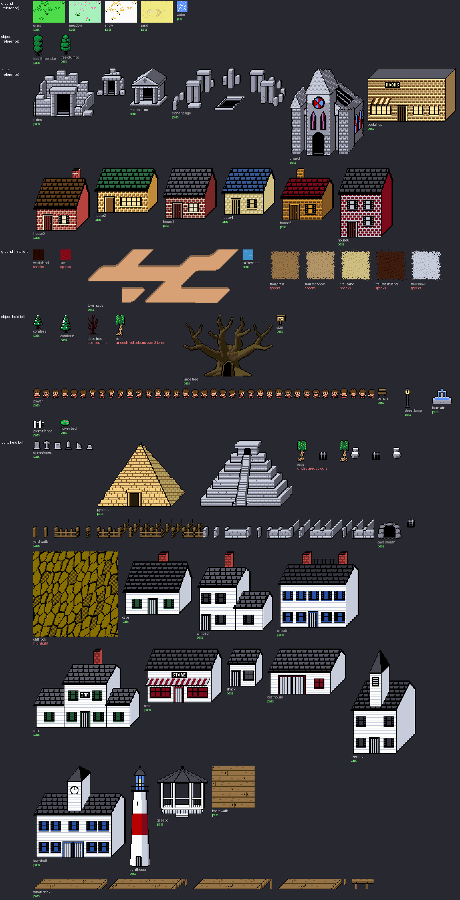

# Overworld style

The rules everything drawn on the overworld follows: its ground, the things
standing on it and the buildings, whatever projection each is drawn in. They
are not chosen: they are measured from the pieces the user is happy with, and
anything else is held to them. `tools/overworld_style.py` holds the measurable
half -- the materials, the list of pieces and the checker. Read this before
touching `art/structures/entrances/`, `art/structures/houses/`,
`art/structures/coast/`, `art/structures/trees/`, `art/cliffs/` or the overworld's cells of
`assets/tileset.png`.

The rules of `ART_DIRECTION.md` still hold underneath: one palette, four
colours a 16px cell. Interiors have their own bible, `INTERIOR_STYLE.md`;
where the two meet, this one says so.



## The reference

(The user, 2026-10-12.)

- **Ground**: the grass, meadow, snow and sand cells and the water cell.
- **Objects**: the two ordinary trees, `art/structures/trees/`.
- **Built**: the seven town houses, `art/structures/houses/`, and the stone
  entrances -- ruins, mausoleum, stonehenge, church.

When a rule here is unclear, the answer is whatever these do. The cliffs are
not reference: they are held to the rest.

## Three kinds

Every piece is one of three kinds, and a kind has its own rules.

- **Ground** lies flat and is walked on: a biome's cells, water, lava, a trail.
- **An object** is one thing standing on the ground, drawn as a sprite: a
  tree, a sign, the player.
- **Built** is a thing made of a material laid in units, or of rock: a house,
  an entrance, a wall, a cliff.

Built pieces follow the interiors' way of drawing a material, objects the
enemy sprites' way of drawing a creature (the user, 2026-10-12), so a brick
outside is a brick inside and a tree is drawn as a Skvader is.

## Across projections

The overworld mixes three views. The texture is what stays the same.

- **Ground is seen from straight above.** No near edge, no far edge.
- **Buildings are oblique**: the front face square on, depth going up and to
  the right at 45 degrees. A point x across, d back and z up lands at
  (x + d, base - z - d) (`entrance_shapes.oblique`, measured off the houses).
  Something lying flat on the ground -- the stonehenge's opening -- is drawn
  as ground is.
- **A cliff is its top from above and its south face square on**; its west and
  east faces are thin and its back is a line.
- **One texture pixel is one screen pixel.** Nothing is scaled, sheared or
  resampled to fit a plane.
- **Three planes, three steps.** The top is the material's lightest tone,
  flat. The front carries the texture. The side turned away (the east) is
  flat and a step darker than the front reads: stone's darkest grey, a house's
  brick without its mortar.
- **Light from the upper left**, as everywhere else in the game.
- **What stands is walked behind.** A piece overflows north of its footprint,
  and each of its pixels is drawn over the player when its ground line is
  nearer the viewer than the feet.

## Materials

A material is named once, in `MATERIALS`, and a piece names the ones it is
made of. The same material is the same colours wherever it appears, outside
and in.

Shared with the interiors (`interior_style.MATERIALS`, lit to dark):

| Material | Tones | Joint |
|---|---|---|
| stone | `c6ccda` `9797aa` `595965` | black |
| sandstone | `f4ce80` `b29e5c` | `785830` |
| wood | `967448` `785830` `493712` | `493712` |
| bark | `605028` `463422` `2d230c` | black |

The overworld's own, from the reference:

| Material | Tones |
|---|---|
| grass | `4edc4a`, tufts `00881b` |
| meadow | `a8f0bc`, flowers `fc74b4`, stems `00a800` |
| snow | `fcfcfc`, tufts `f0bc3c` |
| sand | `f0e880`, dune `e8e0c0` `d0c078` |
| water | `5c94fc`, foam `fcfcfc` |
| foliage | `05c43a` `058f3a` `235436` |
| glass | `5c94fc` `b70000` |
| a house's brick | its own brick, shade and mortar; its roof one tone (`PAL` in its `*_design.py`) |

A house is in its own brick, and its room inside is in the same.

The coastal town's, which is painted wood, not a material laid in units:

| Material | Tones |
|---|---|
| white paint | `fcfcfc` `c6ccda` `9797aa` |
| red paint | `b70000` `7c0a1b` |
| green, navy, black paint | `235436`, `2850a0`, `34343e` |
| slate (roofs, ironwork) | `595965` `474751` |
| lantern glass, lamplight | `5c94fc`, `fae488` |

A coastal house's chimney is the interiors' brick.

The rest -- wasteland, lava, the trails, the town's pads, the sign, the
player, the dead tree -- are not in the reference, so each has its own tones
in the table until it is brought into line.

**Rock that holds ore is in its ore's ramp** (`gen_cave_entrances.py`
`TONES`): a cave's mouth, and a cliff with a cave in it. Stone's ramp there is
`bcbeca` `848694` `474751`, a second grey beside built stone's; a cliff with
no cave takes `b29e5c` `887000` `493712`.

## Ground

- **A ground is its fill.** One flat colour over at least 85% of it (the
  water's 85.9%; grass, snow and sand 91%, meadow 95%).
- **What is laid on it is whole and few**: a tuft, a flower, a dune's rim,
  foam. One or two colours a ground besides its fill.
- **Grains are sparse.** Lone pixels are at most 3% of it (the sand's 2.9%).
- **No outline.** Black is only the dots under a tuft, at most 1.2% (grass
  and snow 1.1%).
- **A biome is its own cells, never a tint** of another's. Where two meet, the
  edge is cut in the neighbour's fill colour.

## Built

A wall is laid in courses, 4 px high: a brick or a stone block 6 px long
(`house_shapes.BRICK_W`, `entrance_shapes.courses`), offset by half a unit
from the course above.

- **A brick** (the houses): its base tone, its shade along its bottom row and
  right edge, pale mortar atop each course and between the bricks. The base is
  the lightest tone of the brick and most of it (42% to 69% of the brick's
  pixels across the seven).
- **A stone block** (the entrances): its top row lit, the rest its base, the
  bed and head joints in the stone's dark tone. This is the one place the
  overworld parts from the interiors, where nothing is lighter than the base:
  at 6 x 4 a block is too small for base, shade and joint, so outside it takes
  a lit row instead (the user, 2026-10-12, over the same wall without the row
  and with the interiors' block).
- **A round pillar** is lit down its left edge and in shade down its right,
  with a ring of shade where its drums meet.
- **A clapboard wall** (the coastal town) is the brick's courses without the
  bricks: each board 4 px high in white paint, the shadow under it along its
  bottom row, no joints. Its side face is the shadow tone, flat. Shutters,
  casing and panes are one paint a house; a painted round tower has no
  lighter stripe, only its paint, shade down its right and a deeper edge.
- **A house's roof** is one tone in rows of shingles, black between them.
- **Rock** (the cliffs) has no units and follows the interiors' rule whole:
  a base that is its lightest tone and most of it, a shade, black cracks. No
  lit tone, no dither.
- **No noise.** Lone pixels are at most 1.4% of a piece (the church's 1.36%;
  the houses' are under 0.3%).

## Objects

- **A 1-px black outline round the whole silhouette**, and between its parts.
- **Three colours and black** (the trees: three greens).
- **One ramp, placed by form**: the mid tone is most of its colour, the dark is massed
  low and on the right, the light is sparse and high on the left (2% to 3% of
  a tree).
- **Flat fills.** No hatching, no lattice, no dither between tones.

## Lines

Black, 1 px. Round the whole of a built piece or an object: every reference
piece's silhouette edge is black all the way round. Where a nearer part
stands in front of a farther one, on the far one's side. Faces of one block
meet without a line; they differ by tone. Ground has none.

## What is not the style

- A colour typed into a design script that is not in `MATERIALS`.
- The same material in two sets of colours: bark browner outside than in, a
  palm's leaves in another green than a tree's.
- A lit tone or dither in rock.
- A ground speckled all over, or outlined.
- An object without its outline, or in more than three colours.
- A texture stretched or sheared to fit a slanted face.
- A side face lighter than the front it turns from.

## How to check

```
python tools/overworld_style.py                   # every piece
python tools/overworld_style.py grass ruins       # some
python tools/overworld_style.py --measure         # the figures the thresholds are set from
python tools/overworld_style.py --board art/direction/overworld_board.png
```

One row a piece, a count per rule, non-zero exit on any failure:

| Rule | Kinds | Fails when |
|---|---|---|
| `pal` | all | a colour is off `game_palette.gpl` |
| `col` | all | a 16px cell holds more than four colours |
| `ramp` | all | a colour belongs to none of the piece's materials |
| `speck` | ground, built | lone pixels of a tone are over 3% of a ground, 1.4% of a built piece |
| `lit` | built | a tiling texture's lightest tone is under 30% of its material: a highlight |
| `flat` | ground | its fill covers under 85% of it |
| `line` | ground | over 1.2% of it is black |
| `out` | object, built | under 99% of its silhouette's edge is black |
| `tones` | object | it has more than three colours besides black |

The first five are `interior_style.check()`, read against the piece's own
materials.

A pass is necessary, not sufficient. The checker cannot see a unit's size,
where its lit row or its shade sits, which tone a plane takes, the projection,
or whether an object is shaded by form. Those are read off the board. Where a
piece has a source drawing it reads that, not the copy stamped into the sheet,
and it reads the cliff's texture in the plain ramp, not as the game paints it
per island. A new
piece is checked once it is added to `PIECES`.

## Not covered

Effects (steam, a weapon's swing). The menu's icons and a craftable placed in
the world have their own bible, `ITEM_STYLE.md`. What has no art yet
and still draws as a placeholder -- rocks, ore, bridges, flower and oilbloom
nodes, villages -- is drawn to this bible when it is drawn.

## Rulings

The reference is the ground cells, the water, the two trees, the seven houses
and the four stone entrances; the cliffs are held to them (the user,
2026-10-12).

Built pieces and rock take the interiors' rule and its materials; living
things and small objects take the enemy sprites' (the user, 2026-10-12).

Stonework outside keeps the lit top row on each block (the user, 2026-10-12).
See "Built".

No piece was changed when this was written. What fails is brought into line
one piece at a time, an image before each install.

The large tree is in the bark of its inside, the plate tone over most of each
limb and its shade down the right (the user, 2026-10-12, over the same tones
with the old shading, and over keeping its paler brown as a material of its
own). Its limbs are placed by hand: four, heavy and bent, a short branch or
two each, spread apart. The tree grown from a seed, forking down to a thicket
of black twigs, was thrown out though it passed every rule ("too clustered up
top and doesnt match the games pixel art"; of two drafts, four bent limbs over
five fanned). A shape is drawn, few parts and bold, not generated: the checker
cannot see this.

The coastal town (town 1, on the ocean) is New England seaport building:
"new england coastal architecture similar to a historic fishing and seaport
town. with a lighthouse and wooden nantucket style houses" (the user,
2026-10-12). Its houses are white clapboard with dark shutters, over grey and
over cedar shingle; its lighthouse the tall white tower with a red band, over
a short harbour light and a tower with a keeper's house, and a landmark, not
a way in. The shop's sign reads STORE. There is a town centre: a town hall, a
bandstand and a green's things ("need more building variety/ maybe like a
town center/park"). All of it lies on the sheet at rows 180-190 for the user
to edit by hand; the sheet is the drawing, and the design files are how it
was first laid out.

The town is laid out (`tools/town1_layout.py`, then by hand in the tile
editor): the green in the middle with the town hall behind it, streets out
from it in the start town's road pieces. Its waterfront is not fixed in
place: "their is a road going towards the water. once over the water it turns
into boardwalk like the one used in graveyards. on this boardwalk is the
lighthouse and finishing huts", and "make sure the boardwalk goes toward the
direction of the world border that is water" (the user, 2026-10-12). The
planks are the graveyard dungeon's own boardwalk, and the deck is drawn as
the dungeon draws it: "the pier needs to be oblique projected shape" (the
user, 2026-10-12, of a first deck laid square to the tiles). Its sides run up
and to the right at 45 degrees as the houses' depth does, a black line round
the floor, the planks' face under every edge -- lit where it looks south,
shaded where it looks east -- and the posts under that, standing in the sea.
To a north or south sea the road goes back at 45 degrees, which in this
projection is straight away from the viewer, and the wharf carries on along
the same line; the wharf is one long deck, the lighthouse at its seaward tip
(over a platform, and over a spur for the lighthouse).

The yard fence is in the interiors' wood, its shape as it was: two posts a
cell, two rails (the user, 2026-10-12, over a stouter post a cell). Its tops
take the lightest tone, its fronts the next, its sides the darkest.
